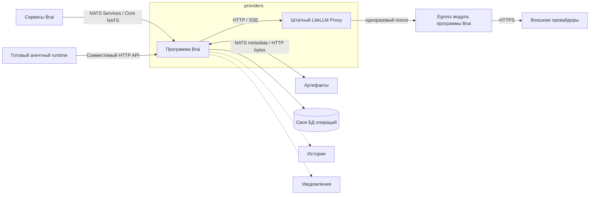

# Спецификация providers

**Состояние:** целевая спецификация; экспериментальный v0 реализуется по CONTRACT.md, live-приёмка ещё не завершена.
**Дата:** 2026-10-19.
**Владелец:** `services/providers`.

Этот документ задаёт проект сервиса и этапы его реализации. Наличие описанной
операции не означает, что она уже доступна. Реальный `CONTRACT.md`, AsyncAPI
и JSON Schema Draft-07 появляются вместе с соответствующей реализацией и
перечисляют только работающие операции. Задачи и разрешения на выполнение
ведутся отдельно в учёте проекта.

## 1. Назначение и полный результат

`providers` — общая граница Brai для обращения к внешним моделям. Потребитель
передаёт выбранную модель, входные данные и параметры; сервис обращается к
провайдеру через LiteLLM и возвращает результат, поток событий и ссылки на
готовые Артефакты.

Полный первый выпуск MUST поддерживать:

- структурированные решения TypeSafe Jev;
- чат хотя бы с одной внешней моделью, проверенной на потоках и инструментах;
- потоковую передачу текста и вызовов инструментов;
- несколько вызовов инструментов за ход и продолжение после их результатов;
- входные и выходные файлы через публичный контракт Артефактов;
- ограниченные ресурсы, учёт операций, отмену и явный неизвестный исход.

Минимальный MVP Jev — первая задача и промежуточный результат. Он не завершает
сервис. Потоки и инструменты входят в обязательную приёмку полного выпуска.
Универсальность означает единый доступ и расширяемые операции; она не означает,
что каждая модель поддерживает все возможности или что каждый API LiteLLM
автоматически опубликован в Brai.

## 2. Границы и устройство



Внутри сервиса две программы: небольшая программа Brai на TypeScript и
закреплённая штатная версия LiteLLM Proxy. Готовая внешняя программа
подключается по её HTTP/SSE API без дополнительного JSON-RPC-посредника.
LiteLLM доступен только программе Brai во внутренней сети. Для TypeSafe v0
непрозрачный egress-модуль той же TS-программы передаёт POST на фиксированный
upstream только после запроса LiteLLM. Одноразовый случайный nonce атомарно
claim-ится до внешней отправки; replay/late/unknown nonce отклоняется. Это
не отдельная программа или универсальный proxy. Причина — stock1.104.2
безусловно повторяет HTTP POST после RemoteProtocolError/ConnectError;
параметр num_retries=0 эту внутреннюю ветвь не отключает. Egress сохраняет
только наличие исходного usage и counts до нормализации LiteLLM в нули. Потребители не
обходят правила `providers`, обращаясь к LiteLLM напрямую.

Первый полный выпуск использует один экземпляр программы Brai. Репликация,
распределённые lease, Redis и балансировщик не входят в начальную реализацию.
Каталог, работа с файлами и учёт операций — модули одной программы, а не
отдельные микросервисы. Ядро получает операции модели, файлов и хранилища через
явные прикладные порты; оно не импортирует NATS, HTTP, SQL или чужие исходники.

| Ответственность | Готовое в LiteLLM | Своя часть Brai |
| --- | --- | --- |
| Внешние API | Адаптеры и преобразование протоколов | Разрешённые операции и маршруты |
| Авторизация | Авторизация у провайдера | Доступ потребителя, доверенный владелец, ссылки на секреты |
| Поток | Приём и нормализация потока провайдера | События Brai, пределы буферов, итог после обрыва |
| Инструменты | Передача определений, вызовов и результатов | Полнота данных и проверка контракта; исполнение у caller |
| Jev | TypeSafe adapter, System One / Decisions API | Операция `decide` и проверка её входа и результата |
| Файлы | Доступные провайдеру upload/download API | Доступ к Артефактам, сохранение, связи и очистка |
| Надёжность | Технические механизмы клиента | Правила повторов, дедлайны, отмена и журнал операций |

Используем LiteLLM без форка. Новый совместимый endpoint подключается
конфигурацией; новый протокол — штатным custom handler с собственными проверками.
Адаптеры не должны появляться в вызывающих сервисах.

## 3. Провайдеры, подключения и каталог

- Провайдер — внешний API, например `typesafe`.
- Подключение — конкретные endpoint, учётная запись и ссылка на секрет.
- Карточка модели — разрешённая пара подключения и точного model ID с операциями,
  форматами, параметрами и известными пределами.

Один декларативный источник конфигурации задаёт настройки LiteLLM и публичную
проекцию каталога Brai. Отдельные редактируемые реестры и LiteLLM Admin UI
для начального выпуска не нужны. Специфичные для экземпляра адреса и пути
секретов передаются извне; продукт работает без репозитория admin.

Caller не передаёт API-ключ, произвольный `baseUrl` или чужую учётную запись.
Каталог возвращает только разрешённые ему карточки. Владелец пользовательского
запроса приходит от доверенной границы Brai; сам `ownerId`, UUID операции или
UUID артефакта не даёт полномочий. Браузер не обращается к NATS напрямую.

Возможность имеет явное состояние: поддержана и проверена, заявлена, неизвестна
или не поддержана. Наличие модели в upstream `/models` не доказывает работу
инструментов, файлов или конкретного API. Неизвестные лимиты и стоимость —
`null`, а не придуманные значения. Выбранная и фактически ответившая модели
возвращаются отдельно; moving alias не считается закреплённой версией.

Jev использует отдельную операцию решений. В исходном проверяемом профиле:
текстовый `state`, `noul`, `choice`, `score`; чат, стриминг и инструменты
не поддержаны. Экспериментальные изображения и расширения Jev не входят в MVP.

## 4. Первый минимальный MVP: экспериментальный v0

Путь: доверенный NATS caller → программа Brai → LiteLLM `/v1/systemone` →
одноразовый egress в той же TS-программе → TypeSafe `/v1/systemone` → тот же caller.

MVP имеет ровно один прикладной endpoint:
`brai.providers.v0.invoke.decide`. NATS Services identity — `brai_providers`,
с уникальным instance ID, версией реализации и PING/INFO/STATS.

Минимальный вход:

```json
{
  "requestId": "<UUID>",
  "ownerId": "<trusted owner>",
  "provider": "typesafe",
  "model": "jev-1.13.0",
  "state": "Customer asks to refund a duplicate charge.",
  "questions": {
    "refund": {"type": "noul", "instructions": "Is a refund requested?"}
  },
  "deadlineAt": "<RFC3339 absolute deadline>"
}
```

Значения `requestId`, `ownerId` и `deadlineAt` выше — обозначения полей, не
готовый запрос. В MVP `state` — непустая строка, `questions` содержит ровно
один вопрос `noul` с непустой строкой `instructions`, без `criteria`. Более
широкие структуры upstream API не обещаются. Вопрос и ответ следуют формату
System One; создаётся только нужное закрытое подмножество схем. `choice`,
`score` и структурированный state добавляются с полным `decide` в v1.

Синхронный успешный ответ содержит `requestId`, `provider`, `requestedModel`,
`actualModel`, `answers`, `usage`. `usage` содержит `inputTokens` и
`outputTokens` либо `null`, если upstream не сообщил их. Вероятности,
распределения и `confidence` сохраняются без округления и подстановок.
Полнота и тип каждого ответа проверяются до успешного ответа caller.

Модель закрепляется в конфигурации стенда; `jev-1.13.0` — исходный кандидат,
доступность которого проверяется при реализации. Замена на другую точную
версию требует обновить профиль и приёмку, а не молча использовать latest.
Весь исходящий модельный трафик идёт через LiteLLM; прямой запрос TypeSafe
из программы Brai не принимается как результат MVP.

В MVP нет БД, каталожного API, файлов, фоновых операций, потоковых subjects,
инструментов, UI, History или Alerts. `requestId` связывает ответ с запросом,
но не обеспечивает дедупликацию. Потеря ответа означает неизвестный исход;
caller не повторяет платный вызов автоматически. Дедлайн, ограничение размеров,
параллелизма и безопасные ошибки обязательны уже здесь.

`v0` предназначен только для изолированной проверки. Переход к `v1` — явная
смена версии API: синхронный ответ v0 не заменяется асинхронным под тем же
subject. Постоянные потребители не интегрируются с v0. Удаление v0 после
перехода отдельно отражается в реальном контракте.

## 5. Целевой интерфейс v1

| Subject suffix: `brai.providers.v1.*` | Результат |
| --- | --- |
| `models.list`, `models.get` | Разрешённый каталог и карточка возможностей |
| `invoke.decide` | Принимает одну операцию решения |
| `invoke.chat` | Принимает один ход модели, включая определения или результаты инструментов |
| `operations.get` | Состояние и сохранённый полный итог в области владельца |
| `operations.cancel` | Состояние запроса отмены, без обещания внешней остановки |
| `status` | Готовность NATS, БД, LiteLLM и нужных возможностей |

Команды используют NATS Services, queue group `brai_providers`, прямые DTO
без JSON-RPC и заголовки `Nats-Service-Error` / `Nats-Service-Error-Code`.
Схемы принадлежат `providers`; потребители используют опубликованные ссылки
на них. Payload, error mapping и сроки описываются в AsyncAPI при реализации.

Вызов v1 содержит устойчивый `operationId`, корреляционный `requestId`,
доверенный `ownerId`, `connectionId`, точный `modelId`, `deadlineAt`, тип входа
и допустимые параметры. `invoke.*` отвечает после устойчивого принятия
операции. Ответ содержит operation ID и состояние, а не готовый результат.
Невалидный вход или исчерпанная ёмкость отклоняются до внешнего вызова.

Контекст передаётся явно: система сообщений, текст, результаты инструментов
и ссылки на Артефакты. `providers` не читает чаты, проекты или Историю для
самостоятельного расширения контекста. Неизвестные параметры отклоняются;
настройка LiteLLM, молча удаляющая неподдержанные параметры, отключена.

События содержимого выдаются в приватный inbox доверенного caller. Перед
`invoke` он создаёт подписку; адаптер проверяет допустимое пространство inbox
по конфигурации и NATS ACL. Произвольный subject из клиентского payload не
принимается. Общие broadcast subjects не содержат пользовательский контекст.

## 6. Потоки и завершение

Вход LiteLLM — HTTP/SSE, выход Brai — Core NATS; HTTP-совместимый вход из
раздела 11 возвращает SSE. Каналы не меняют прикладную семантику.

Событие имеет `operationId`, возрастающий `sequence` и закрытый тип:
`started`, `text.delta`, `tool_call.delta`, `tool_call.ready`, `usage`,
`artifact.ready`, `completed` или `error`. Фрагменты нескольких блоков
сопоставляются по устойчивому ID/индексу; сохраняется порядок внутри блока.
Расширение reasoning передаётся только при поддержке и разрешении upstream;
скрытые внутренние рассуждения не восстанавливаются и не придумываются.

Аргументы инструмента могут приходить неполными JSON-фрагментами. На
`tool_call.delta` ничего не выполняется. `tool_call.ready` появляется только
после сборки полного аргумента и проверки формы; финальный DTO содержит все
полные вызовы и завершённое сообщение модели.

Core NATS не хранит сообщения и не обещает replay после отключения.
Пропуск обнаруживается по `sequence`. Потеря финального уведомления решается
чтением `operations.get`, без нового обращения к модели. События не являются
единственным носителем итоговых инструментов или ответа. Не обещаем
восстановление каждого токена либо продолжение оборванного upstream-потока.

Для HTTP reader и NATS writer действуют конечные byte budgets. HTTP adapter
может замедлить чтение upstream при обратном давлении своего соединения в
пределах дедлайна. Core NATS не подтверждает обработку каждым подписчиком:
он не позволяет обещать такое замедление по фактической скорости caller.
Переполнение локального буфера или таймаут прерывают живую доставку явно;
сохранение ограниченного финального результата может продолжиться. Нельзя
молча пропустить фрагменты и сообщить, что поток доставлен полностью.
Клиентские буферы также ограничены и обрабатывают slow-consumer как разрыв.
Подтверждение локальной публикации не означает доставку подписчику.
Управляющие команды `get/cancel/status` имеют отдельную ограниченную ёмкость.

`completed` выдаётся после фиксации доступного итога. Внешний `finish_reason`
сохраняется; завершение хода с `tool_calls` не означает завершение всей задачи
агента. При обрыве частичный текст явно помечен частичным и не заменяет успех.

## 7. Инструменты и продолжение

Операция `invoke.chat` — один ход модели. Цикл и исполнение инструментов
принадлежат агентному runtime или другому вызывающему сервису:

1. Caller передаёт сообщения и определения доступных инструментов.
2. Модель возвращает один или несколько вызовов с устойчивыми ID.
3. Caller проверяет доступ, исполняет инструмент и получает результат.
4. Caller передаёт результаты с теми же tool-call ID новым `operationId`.

`providers` не запускает bash, не меняет рабочие файлы и не исполняет
произвольные инструменты. Автоматический MCP execution LiteLLM не включается
в начальном выпуске. Возможности tool gateway не смешиваются с модельным API.

Модель получает исходные определения и результаты без потери порядка,
ошибок инструментов или идентификаторов. Provider-specific response IDs,
подписи и replay metadata сохраняются как непрозрачное проверяемое состояние.
Ссылка на это состояние привязана к владельцу, подключению и допустимому
маршруту; неизвестный или истёкший state не подменяется пустым. Полный контекст
остаётся у caller; сервис не создаёт вторую историю агентного диалога.

Нельзя обещать одинаковые нативные возможности для всех провайдеров. Различия
явно описываются в карточках и mapping; неподдержанное продолжение даёт
`UNSUPPORTED_OPERATION`, а не скрытое удаление подписей или частей сообщений.

## 8. Артефакты и путь файлов

Контракт соседа — [artifacts](../artifacts/CONTRACT.md). Метаданные идут по
NATS, байты — по HTTP. Чужие таблицы и каталоги файлов не используются.

### Принятый файловый профиль v1

Текущая реализация принимает `artifactIds` только как text/plain context для
Decide/Chat/Image. Выход — один PNG1024×1024 от Google Gemini2.5 Flash Image
через stock LiteLLM1.104.2/OpenRouter. Остальные форматы остаются возможностями
будущих отдельно принятых профилей. Pending bytes находятся в собственном
PG journal (≤32MiB, два слота, TTL24h); replay/startup возобновляют только
сохранение прежних bytes/requestId. Фактические DTO и лимиты — в
[CONTRACT](CONTRACT.md#v1-текстовые-артефакты-и-один-image-output).

### Вход

Caller передаёт `artifactId` и назначение (`context`, изображение или иной
явно поддержанный input). Адаптер читает metadata, сверяет owner, ready, MIME,
размер, SHA-256 и доверенный files origin, затем читает ограниченный поток.
Проверка metadata не заменяет обработку удаления файла во время чтения.

Дальше профиль выбирает явно: включить текст в контекст, передать media либо
загрузить файл в upstream Files API. Исходный файл не дублируется в Артефактах
без преобразования. Для сохранённой производной копии используется `kind=copy`
и связь с original. Произвольные PDF/office/archive extraction не добавляются
без соответствующей операции и её приёмки.

Внешнему API не передаётся внутренний URL Brai. Временные upstream file IDs
привязаны к учётной записи и операции; их нельзя переносить между подключениями.
Очистка временных локальных/внешних файлов ограничена сроком и учитывает сбои.
Неподтверждённое удаление не объявляется успешным.

### Выход

Для реально возвращённого файла: получить содержимое через LiteLLM или
разрешённый адаптер → `artifacts.prepare` со стабильным requestId → HTTP PUT
→ подтвердить ready → сохранить связь operation/output → вернуть artifact ID.
Внешняя подписанная ссылка или provider file ID сами по себе не заменяют
сохранённый Артефакт Brai. Скачивание допускает только происхождение и способ,
предусмотренные профилем, с лимитами размера и дедлайном.

Генерируемый файл — original результата провайдера. `details` хранит безопасное
происхождение: операция, провайдер и модель; там нет секретных URL или ключей.
Публичная ссылка автоматически не создаётся. Markdown-ссылка в обычном тексте
не считается подтверждённым файловым выходом.

Исход вычисления и сохранение выходов независимы. У файла есть
`pending | ready | failed | unknown`; ответ не объявляет его готовым до ready.
При потере ответа PUT сначала читается metadata уже известного artifactId.
Повтор сохранения использует прежние IDs и доступные байты; модель повторно
не вызывается. Если исходник утрачен, результат помечается потерянным.

Связь operation/output принадлежит `providers`. Agent-specific `reference.*`
и `output.bind` не используются как общий журнал providers. Привязку файла
к сообщению своего чата делает соответствующий потребитель. Файл локального
инструмента публикует владелец исполнения инструмента.

## 9. Операции, данные и отказы v1

Своя БД хранит владельца, operation ID, hash нормализованного входа, выбранный
маршрут и версию конфигурации, этап, фактическую модель, usage, ссылки на выходы
и ограниченный итог. Промпты и контекст не хранятся как постоянная история.
Итог и непрозрачные данные продолжения хранятся ограниченное время; после TTL
get явно сообщает истечение. Файлы имеют lifecycle Артефактов. TTL и предел
итога фиксируются в исполняемой конфигурации до приёмки.

Первичная проверка повтора выполняется по `(ownerId, operationId)` и input
hash до обращения к меняющимся зависимостям. Точный повтор возвращает прежнюю
операцию; другой input даёт конфликт. Принятие и claim внешней отправки
атомарны. Одновременные запросы с одним ключом не запускают две отправки.
Idempotency гарантируется только в явно указанном сроке хранения ключа.

Этапы: `accepted → preparing → dispatching → running → succeeded | failed |
cancelled | outcome_unknown`. Возможен отказ подготовки до внешней отправки.
Журнал фиксирует намерение отправки до вызова LiteLLM. Разрыв между этим
намерением и подтверждённым ответом оставляет unknown; невозможно обещать
exactly-once исполнение у внешнего провайдера. После перезапуска незавершённая
возможная отправка не повторяется автоматически.

Дедлайн ограничивает ожидание и работу локальных адаптеров. Timeout транспорта
не доказывает отсутствие внешнего эффекта. Отмена до отправки может быть
подтверждённой; после отправки хранится запрос отмены и известный внешний исход.
Закрытие HTTP-соединения не доказывает остановку удалённого вычисления или
прекращение списания. Поздний результат не перезаписывает чужую/новую операцию.

Автоматические повторные внешние вычисления, fallbacks, скрытая замена модели
и тихое усечение входа/результата запрещены. Настраиваемые retries отключены
во всех слоях. Если штатный вложенный клиент содержит неотключаемый HTTP replay,
одноразовый egress отклоняет его до второй внешней отправки; эта граница
проверяется управляемым upstream. Модель получает не более одной попытки.
Новая вычислительная попытка требует нового явного operation ID. Повтор
доставки сохранённого результата или файла не является новым вычислением.

Admission, очередь, число внешних обращений, вход/выход, event buffers,
временные файлы и сроки имеют конечные пределы. Значения задаются явно по
профилю и согласуются с payload/timeout NATS и Артефактов. Перегрузка даёт
безопасный отказ до нового платного вызова; ресурсы освобождаются после
завершения использующих их локальных действий.

Ошибки различают невалидный вход, отсутствие доступа/модели, неподдержанную
операцию, переполнение, provider rate limit, отказ зависимости, дедлайн,
отмену, ошибку протокола и неизвестный исход. Поле «можно повторить доставку»
не разрешает повтор вычисления. Upstream body и сырой exception не выходят
на границу и не попадают в журнал. Невалидный ответ не превращается в успех.

## 10. История и уведомления

[History](../history/CONTRACT.md) получает безопасный итог операции: ID,
владелец/область, модель, длительность, outcome, usage и безопасный код отказа.
Текста, tool arguments/results, файлов, URL, API-ключей и произвольных параметров
в событиях нет. Основной учёт операций и расходов не зависит от History.

Исходный выбор справочника на 2026-10-19 подтверждён MCP: execution/execute
1201; подтверждённая отмена — cancel 1202. retry 1209 означает новую бизнес-
попытку, а не повтор доставки. Перед внедрением справочник читается повторно.
Пользовательская область — user/ownerId; события о пользователе не отправляются
в общую system-область. Источник связывается с разрешённым NATS subject.

Для начальной истории достаточно одной ограниченной best-effort Core NATS
публикации после операции, как в Local AI. Пропуск фиксируется метрикой и не
меняет итог. Контракт не обещает её долговечную доставку.

[Alerts](../alerts/CONTRACT.md) получает только проблемы реальных операций.
Startup, health polling и пустые очереди молчат. Продолжающийся сбой объединяется
в эпизод, восстановление закрывает его без нового сообщения. Надёжная доставка
уведомлений использует ограниченный outbox источника и существующий ingest
JetStream; повтор сохраняет ID/содержимое и никогда не повторяет модельный вызов.
Отказ доставки уведомления не создаёт рекурсивное уведомление.

## 11. Потребители и совместимый HTTP-вход

- Local AI остаётся владельцем локальных моделей и их lifecycle. Выбор local
  или external делает потребитель; скрытого перенаправления между ними нет.
- Transcription сможет подключить свой external executor после появления и
  приёмки операции внешнего распознавания. Эта операция не входит автоматически
  в первый выпуск decide/chat.
- Web проверяет сессию и область до передачи owner по доверенному транспорту.
- Текущий Agent — мост к Codex app server; контекст и инструменты остаются у
  этого runtime. Его переключение на providers не считается выполненным одним
  изменением base URL.

Для готовых runtime начальный совместимый HTTP-вход поддерживает только
`POST /v1/chat/completions`, обычный ответ/SSE и function tools, с документированной
матрицей параметров. Он использует то же ядро, admission, проверенный scope и
журнал операций. Сервисная аутентификация и разрешённая область задаются сервером;
недоверенный заголовок owner не считается авторизацией. Требуется доказанная
связь client request ID с operation ID и безопасное сопоставление результата.

HTTP не является альтернативной межсервисной шиной Brai: NATS остаётся основным
входом. Это адаптер готовых внешних программ к их фактическому протоколу.
Полная совместимость OpenAI API, Responses API, OAuth подписок и конкретно
Codex не обещаются без отдельного исследования и приёмки. Прозрачный обход
на LiteLLM, теряющий владельца, учёт или файловые правила, запрещён.

## 12. Проверки и готовность

MVP принимается только настоящим вызовом Jev через оба промежуточных звена.
Mock подтверждает ошибки и число отправок, но не доступность реального API.
Live-проверка использует синтетический короткий вход и закреплённую модель;
в отчёт не попадают ключ, промпт или содержимое ответа.

Полный выпуск дополнительно проверяет реальный поток до финального ответа,
фрагментацию аргументов, два tool calls за ход и второй ход после их результатов,
неисполнение инструментов сервисом, сохранение нативного состояния и отсутствие
скрытых повторов. Нужен хотя бы один внешний chat-профиль с действующим доступом;
Jev эту проверку заменить не может. Наличие доступа выясняется до зависимого
live-запуска. Ошибки, гонки, обрывы и restart проверяются управляемым стендом.

Проверки Артефактов включают чужой/неготовый вход, удаление во время чтения,
потерянный ответ upload, частичный набор выходов и повтор сохранения без
повторной генерации. Операции проверяются на дубликат, конфликт hash,
сохранение финала, неизвестный исход и отмену без ложного утверждения о списании.

Численные пределы и выбранные версии закрепляются до live-приёмки. Версия
LiteLLM должна содержать TypeSafe и нужные stream/tool/file пути; наличие кода
в upstream main не доказывает поддержку выбранного образа. Рабочая установка,
секреты и выпуск выполняются через Ansible только после поручения реализации.
Сейчас не выполняются установка пакетов, платные запросы или развёртывание.

## Источники и соседние контракты

- [Local AI](../local-ai/CONTRACT.md), [Артефакты](../artifacts/CONTRACT.md),
  [История](../history/CONTRACT.md), [Alerts](../alerts/CONTRACT.md),
  [архитектура Agent](../agent/ARCHITECTURE.md).
- [LiteLLM: конфигурация](https://docs.litellm.ai/docs/proxy/configs),
  [Decisions](https://docs.litellm.ai/docs/decisions),
  [streaming](https://docs.litellm.ai/docs/completion/stream),
  [function calling](https://docs.litellm.ai/docs/completion/function_call),
  [custom handler](https://docs.litellm.ai/docs/providers/custom_llm_server),
  [Files API](https://docs.litellm.ai/docs/files_endpoints).
- [TypeSafe: System One API](https://docs.typesafe.ai/api),
  [модели](https://docs.typesafe.ai/models),
  [Jev и coding agents](https://docs.typesafe.ai/introduction/coding-agents).

Внешние источники проверены при проектировании 2026-10-19. Их текущее содержание
и выбранная закреплённая версия повторно проверяются перед реализацией.
